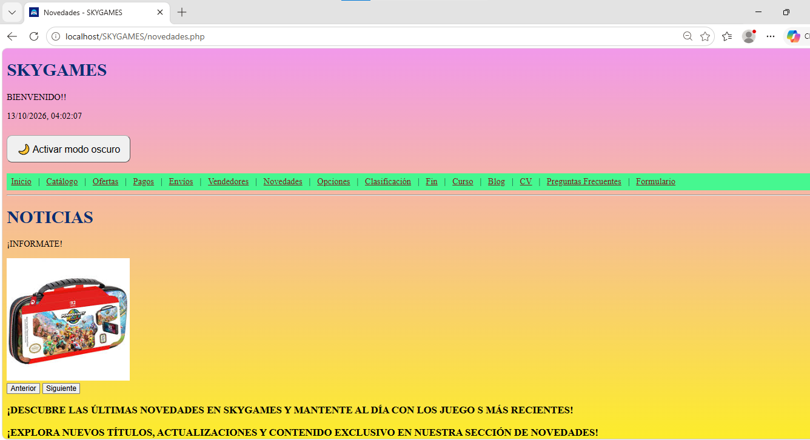
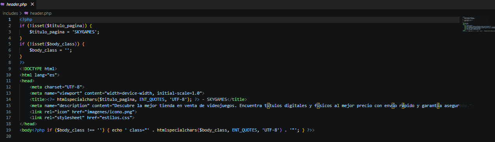
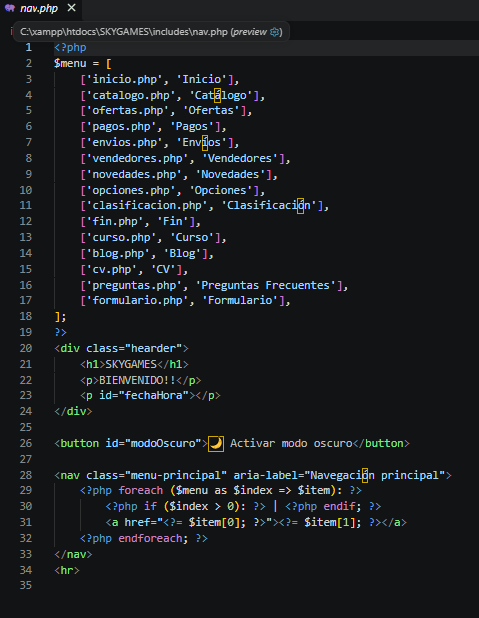
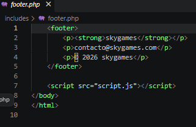
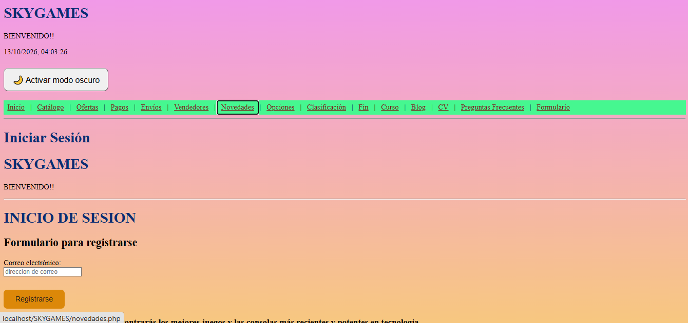
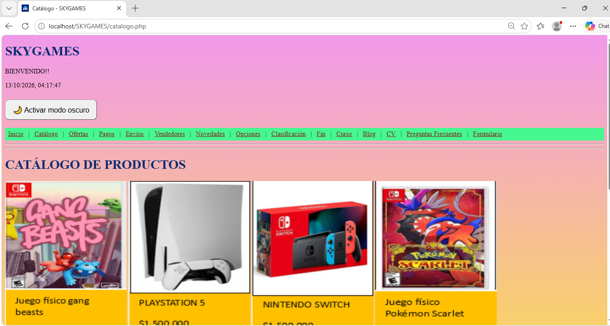
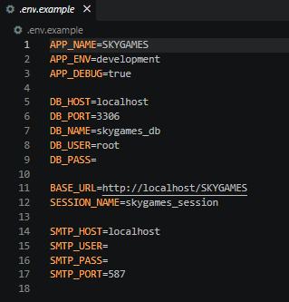

SKYGAMES 🎮

1. Título y descripción del proyecto

SKYGAMES es una aplicación web orientada al mundo de los videojuegos. Su objetivo es presentar información y contenido relacionado con videojuegos mediante una interfaz organizada, con diferentes secciones para facilitar la navegación de los usuarios.

Este proyecto forma parte de la asignatura Programación Web, correspondiente a la Unidad 4: Entorno Servidor y Primeros Pasos con PHP.

Durante esta etapa se realiza la migración de la estructura estática a PHP, la modularización de componentes mediante inclusiones del lado del servidor (SSI) y la incorporación de una configuración basada en variables de entorno, como base para el renderizado del lado del servidor (SSR).

Objetivos de la refactorización

- Migrar las páginas HTML a archivos PHP.
- Reutilizar componentes comunes mediante archivos como "header.php", "nav.php" y "footer.php".
- Implementar títulos dinámicos según la página visitada.
- Mostrar la sección activa en el menú de navegación.
- Organizar la configuración de la aplicación mediante variables de entorno.
- Facilitar el mantenimiento y la ampliación del proyecto.

2. Enlace al prototipo de Figma

El diseño original de SKYGAMES se encuentra disponible en el siguiente enlace:

Prototipo de Figma: https://www.figma.com/site/ySIzeie2WV87gDKjfSQZkZ/%C2%B4pagina-web?node-id=0-1&t=5jQO5pgNRHAd6IlD-1

Este prototipo sirve como referencia visual para el diseño y la organización de las páginas de la aplicación.

3. Tecnologías utilizadas

- HTML5: estructura y contenido de las páginas web.
- CSS3: estilos, colores, distribución y diseño visual.
- Bootstrap: herramientas y componentes para la interfaz, si están incluidos en el proyecto.
- JavaScript: funcionalidades e interacciones del lado del cliente.
- PHP 8.x: procesamiento del lado del servidor, inclusión de plantillas y generación dinámica de contenido.
- XAMPP o Laragon: entorno de servidor local para ejecutar la aplicación.
- Git y GitHub: control de versiones y alojamiento del repositorio.

4. Instalación y ejecución local

Requisitos previos

- Tener instalado Git.
- Tener instalado XAMPP o Laragon.
- Contar con PHP 8.x o una versión compatible con el proyecto.
- Disponer de un navegador web.

Paso 1. Clonar el repositorio

Abrir una terminal y ejecutar el siguiente comando, reemplazando la dirección por la URL real del repositorio:

git clone https://github.com/USUARIO/SKYGAMES.git

Paso 2. Ubicar el proyecto

Si se utiliza XAMPP, colocar la carpeta del proyecto dentro de:

C:\xampp\htdocs\SKYGAMES

Si se utiliza Laragon, colocarla dentro de la carpeta "www" correspondiente a la instalación.

Paso 3. Iniciar el servidor local

En XAMPP, abrir el panel de control e iniciar los servicios Apache y, si el proyecto utiliza una base de datos, MySQL.

En Laragon, iniciar los servicios correspondientes desde su panel.

Paso 4. Configurar las variables de entorno

Revisar el archivo ".env.example" para conocer las variables requeridas por la aplicación.

Si el proyecto necesita un archivo ".env", crear una copia local a partir de ".env.example" y completar los valores necesarios. No publicar contraseñas, claves privadas ni otros datos sensibles.

Paso 5. Abrir la aplicación

Abrir el navegador y acceder a:

http://localhost/SKYGAMES/

Si la página principal no se carga automáticamente, acceder directamente a:

http://localhost/SKYGAMES/index.php

Nota: la ruta puede variar según el nombre de la carpeta y la configuración del servidor local.

5. Evidencia de funcionamiento

En esta sección se incorporarán las capturas de pantalla que demuestran el funcionamiento y el cumplimiento de los requisitos de la Unidad 4.

5.1. Servidor local ejecutándose

Evidencia: insertar una captura de SKYGAMES abierto en el navegador mediante "http://localhost/SKYGAMES/".

La captura debe mostrar la interfaz de la aplicación y la dirección local utilizada para ejecutarla.

Captura:

5.2. Estructura modular mediante SSI

La aplicación organiza los componentes compartidos en archivos PHP independientes, con el objetivo de evitar la duplicación de código y facilitar su mantenimiento.

Archivos principales:

SKYGAMES/
├── includes/
│   ├── header.php
│   ├── nav.php
│   └── footer.php
├── index.php
├── catalogo.php
├── novedades.php
├── ofertas.php
├── estilos.css
├── script.js
├── .env.example
├── .gitignore
└── README.md

Esta estructura es ilustrativa; los nombres y archivos deben coincidir con los que realmente existen en el repositorio.

Evidencia: insertar capturas del código de "header.php", "nav.php" y "footer.php", donde se observe la separación de las plantillas y su inclusión desde las páginas PHP.

Capturas:

- 
- 
- 

5.3. Navegación dinámica

La navegación dinámica permite identificar la sección que está visitando el usuario y establecer el título correspondiente en cada página.

El título se configura mediante una variable PHP, por ejemplo:

$titulo_pagina = "Catálogo";

El menú puede utilizar la clase CSS "active" para destacar la sección actual.

Evidencia: insertar capturas de dos páginas diferentes que demuestren:

- El cambio del título en la pestaña del navegador.
- El cambio de la clase "active" en el menú según la sección visitada.

Capturas:

- 
- 

5.4. Configuración de variables de entorno

El archivo ".env.example" contiene una plantilla de las variables de configuración necesarias para ejecutar el proyecto, sin incluir credenciales privadas.

Ejemplo ilustrativo:

APP_NAME=SKYGAMES
APP_ENV=local
SUPPORT_EMAIL=soporte@example.com

Las variables definitivas deben coincidir con las que utiliza la aplicación. El archivo ".env.example" debe permanecer en el repositorio, mientras que el archivo ".env" con valores locales debe excluirse mediante ".gitignore".

Evidencia: insertar una captura del archivo ".env.example" abierto en Visual Studio Code.

Captura:

6. Resultado esperado

Con esta refactorización, SKYGAMES contará con una estructura basada en PHP que facilita la reutilización de componentes, la navegación entre secciones y la organización de la configuración del proyecto.

La documentación y las capturas permitirán comprobar la ejecución local, la modularización mediante SSI, la navegación dinámica y la presencia de la plantilla de variables de entorno.

7. Autoría

Proyecto: SKYGAMES
Asignatura: Programación Web
Unidad: Unidad 4 – Entorno Servidor y Primeros Pasos con PHP
Modalidad: Individual
